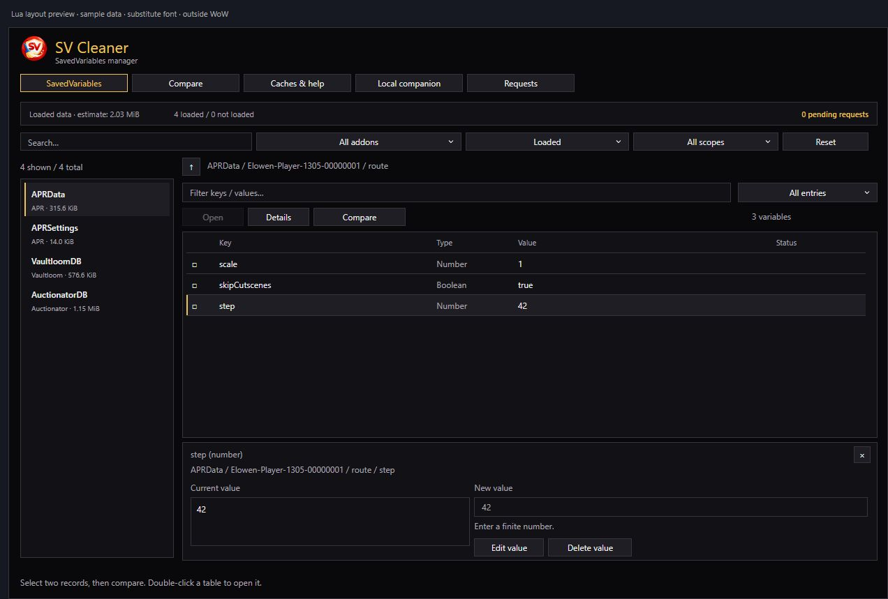
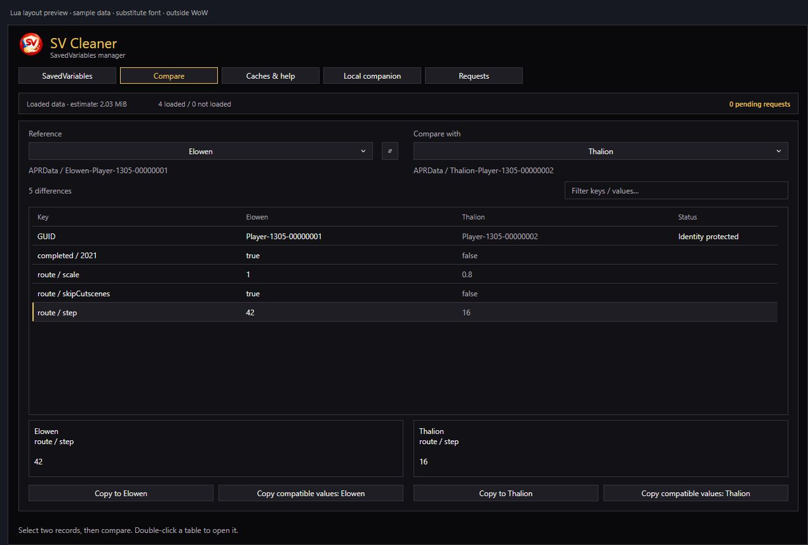

<a name="readme-top"></a>

<p align="center">
  
</p>

<h1 align="center">Your data. A clearer interface.</h1>

<p align="center">
  A <strong>SavedVariables</strong> and temporary data manager for <strong>World of Warcraft</strong>.<br>
  Find your addons' data, compare your characters, and prepare your cleanup.<br>
  An <strong>in-game addon</strong> to explore. A <strong>local companion</strong> to back up and apply changes.
</p>

<p align="center">
  <a href="#installation"></a>
  <a href="#local-companion"></a>
</p>

<p align="center">
  <a href="#getting-started"><strong>Get started</strong></a> &nbsp;·&nbsp;
  <a href="#features"><strong>Features</strong></a> &nbsp;·&nbsp;
  <a href="#characters-and-comparison"><strong>Comparison</strong></a> &nbsp;·&nbsp;
  <a href="#compatibility-and-languages"><strong>Compatibility</strong></a> &nbsp;·&nbsp;
  <a href="#commands"><strong>Commands</strong></a>
</p>

---

## Getting started

<table>
  <tr>
    <td width="50%" valign="top">
      <h3>01 &nbsp; Choose your WoW version</h3>
      <p>Run <code>Lancer-SVCleaner.cmd</code>. The companion opens your browser and lists the game versions found in your installation.</p>
      <p>Choose your client in the <strong>WoW version</strong> selector. The inventory and backups belong to that client folder.</p>
    </td>
    <td width="50%" valign="top">
      <h3>02 &nbsp; Find your data</h3>
      <p>Browse files by addon, account, and character. Search for a variable, inspect its contents, and identify files with no matching installed addon.</p>
      <p>In WoW, type <code>/svc</code> to explore the variables of loaded addons.</p>
    </td>
  </tr>
  <tr>
    <td width="50%" valign="top">
      <h3>03 &nbsp; Prepare your changes</h3>
      <p>Edit a value, compare two characters, or select several files for deletion. Review the <strong>before and after</strong> values.</p>
      <p>The grid aligns <strong>keys, types, values, and status</strong>. Identity fields remain protected.</p>
    </td>
    <td width="50%" valign="top">
      <h3>04 &nbsp; Back up and apply</h3>
      <p>Close all WoW clients, then apply the pending changes in the companion. Original files are backed up before any writes.</p>
      <p>Use the history to inspect a transaction, measure its changes, or prepare a restore.</p>
    </td>
  </tr>
</table>

> [!NOTE]
> The addon prepares requests; the companion applies them to files while WoW is closed. To retrieve requests prepared in game, log out, close WoW, then import the in-game requests in the companion.

## Installation

### WoW addon

Install SV Cleaner directly from [CurseForge](https://www.curseforge.com/wow/addons/svcleaner/preview) or [Wago](https://addons.wago.io/addons/svcleaner).

### Local companion

With Python **3.10 or newer**, double-click **`Lancer-SVCleaner.cmd`**, or specify your game client folder:

```powershell
python companion/app.py --wow "D:\Jeux\World of Warcraft\_retail_"
```

The companion uses Python's standard library, listens on **`127.0.0.1`**, and opens your browser. Your data stays on your PC. Press **Ctrl+C** in its console to stop the server and discard pending changes that have not been applied.

The companion interface is currently in **French**. The steps below describe its actions in English.

To try the interface with isolated sample data:

```powershell
python companion/app.py --demo
```

---

<p align="center">
  
</p>

## Features

<table>
  <tr>
    <td width="50%" valign="top">
      <h3>🔎 &nbsp; Inventory and exploration</h3>
      <ul>
        <li><strong>Addon / SavedVariables mapping</strong> from TOC declarations and the manifest.</li>
        <li><strong>Combined filters</strong> for addon, loaded state, and scope in game; accounts, characters, and files in the companion.</li>
        <li><strong>Readable data grid</strong> with key, type, value, and status columns, plus navigation into nested tables.</li>
        <li><strong>Selection details</strong> and searching through keys and values in the open block.</li>
      </ul>
    </td>
    <td width="50%" valign="top">
      <h3>✏️ &nbsp; Editing and cleanup</h3>
      <ul>
        <li><strong>Scalar value editing</strong> that preserves the original type: text, number, or boolean.</li>
        <li><strong>Bulk deletion</strong> in the companion: select individual files or all filtered results.</li>
        <li><strong>Orphaned files and backup copies</strong> listed separately so you can review what to remove.</li>
        <li><strong>Pending changes and before/after review</strong>, original-file backups, and restore history.</li>
      </ul>
    </td>
  </tr>
  <tr>
    <td width="50%" valign="top">
      <h3>👥 &nbsp; Characters and profiles</h3>
      <ul>
        <li><strong>APR character blocks</strong>, including GUID-associated entries in <code>APRData</code>.</li>
        <li><strong>Browsable AceDB structures</strong>: <code>char</code>, <code>profileKeys</code>, and <code>profiles</code>.</li>
        <li><strong>Named comparisons</strong>: check two entries in the addon, then inspect differences in aligned columns.</li>
        <li><strong>Copies to an explicit recipient</strong>, for one value or the compatible values in a block.</li>
      </ul>
    </td>
    <td width="50%" valign="top">
      <h3>📊 &nbsp; Storage and maintenance</h3>
      <ul>
        <li><strong>Actual disk usage</strong> and per-addon charts in the companion.</li>
        <li><strong>Loaded-data estimates</strong> in game, separate from file sizes.</li>
        <li><strong>Change history</strong> and measurements of data removed from active files.</li>
        <li><strong>Cache guidance</strong> in game and backed-up resets of the client's <code>Cache</code> or <code>GPUCache</code> folder while WoW is closed.</li>
      </ul>
    </td>
  </tr>
</table>

Both interfaces offer **light and dark themes**. The addon window can be moved and resized; menus close on outside clicks or **Escape**. The window closes when you enter combat.

### In game and on disk

| Function | In-game addon | Local companion |
|---|---|---|
| Explore variables | Accessible data from loaded addons | Files in the selected WoW client folder |
| Inspect other characters | Character blocks in loaded account-wide variables | Character folders and account-wide variables |
| Edit, delete, or copy | Prepare requests | Back up and apply file changes |
| Identify orphaned files | — | Match files against installed addons |
| Measure storage | Bounded estimates of loaded data | Actual bytes, charts, and history |
| Maintain caches | Command and settings guidance | Rename a cache folder with restore support |

A **disabled but installed** addon is still installed. A file declared by another addon is marked as **linked / needs review**. Blizzard data and SV Cleaner's own data are protected.

## Characters and comparison

In the addon, open a variable such as `APRData`, **check two entries**, then click **Compare**. Column headers show character or profile names; each row aligns a key and its two values. Select a difference to inspect it and use **Copy to [character]**.

In the companion, select the addon, account, and two characters or profiles in the comparison view. You can also compare compatible per-character files belonging to the same account.

Copies preserve destination keys and the parent identifier. They operate on existing values of the same type. **GUIDs, IDs, and identity fields**, missing keys, and incompatible types remain visible but cannot be copied through these actions.

**“Not observed” does not mean “deleted character.”** The registry only knows characters encountered since installation, and an old WTF folder may remain. Review these clues before cleaning up.

<details>
  <summary><strong>Data grid and comparison previews</strong></summary>
  <p>These previews use the Lua layout with sample data and a substitute font. They are rendered outside the game.</p>
  <p></p>
  <p></p>
</details>

---

<p align="center">
  
</p>

## Backups and applying changes

1. **Prepare** changes in the addon or companion.
2. **Close WoW** after logging out; import in-game requests when needed.
3. **Review the pending changes**, then choose **Back up and apply**.
4. **Open the history** to find original files or restore a transaction compatible with the current file contents.

Original files and the journal are stored in `data/<installation>/<transaction>`. The companion checks file contents before writing; a restore refuses to overwrite data that has changed in the meantime.

Data **removed from active files** is different from physical disk space freed: retained backups still occupy storage. Resetting a cache does not guarantee better FPS or latency.

## Compatibility and languages

The shipped TOCs declare the following client families:

| Family | Dedicated TOC |
|---|---|
| Retail | `SVCleaner_Mainline.toc` |
| Classic Era / Hardcore | `SVCleaner_Vanilla.toc` |
| TBC / Anniversary | `SVCleaner_TBC.toc` |
| Wrath / Titan | `SVCleaner_Wrath.toc` |
| Cataclysm | `SVCleaner_Cata.toc` |
| Mists of Pandaria | `SVCleaner_Mists.toc` |
| Forever / Camelot | `SVCleaner_Camelot.toc` |

PTR and beta clients use their corresponding declared interfaces. The companion identifies the client family from the installation metadata; ambiguous clients remain marked as uncertain. Automated checks do not replace testing in each exact game client.

The addon follows WoW's language: **English, French, German, European and Latin American Spanish, Italian, Brazilian Portuguese, Russian, Korean, Simplified Chinese, and Traditional Chinese**. The `enGB` and `ptPT` aliases use the `enUS` and `ptBR` catalogs respectively. The local companion is in **French**.

---

<p align="center">
  
</p>

## Commands

| Command | Action |
|---|---|
| `/svc` or `/svcleaner` | Open or close the in-game interface |
| `python companion/app.py --wow "…"` | Open the companion for the specified game client folder |
| `python companion/app.py --demo` | Try the companion with sample data |

## License

Copyright (c) 2026 **Neogeekmo**. SV Cleaner's original code, documentation, and artwork, including the addon and local companion, are distributed under the [MIT License](LICENSE). You may use, modify, and redistribute them, including commercially, provided you retain the copyright and license notice. The software is provided without warranty, subject to applicable law. See the [MIT license text](https://opensource.org/license/mit).

The [project notices](NOTICE) explain third-party rights, Blizzard trademarks, and precautions for SavedVariables cleanup. Blizzard's [UI Add-On Development Policy](https://us.forums.blizzard.com/en/wow/t/ui-add-on-development-policy/24534) applies separately and requires free addon distribution and publicly accessible addon code. SV Cleaner is an independent project and is not endorsed by Blizzard Entertainment.

## Credits

**Neogeekmo** — project author.

---

<p align="center">
  <strong>SV Cleaner</strong><br>
  Readable data. Reviewable changes.<br><br>
  <a href="#readme-top">Back to top ↑</a>
</p>
